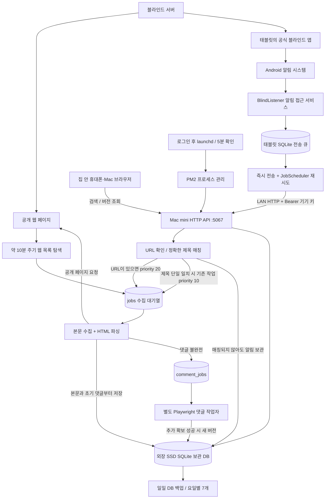
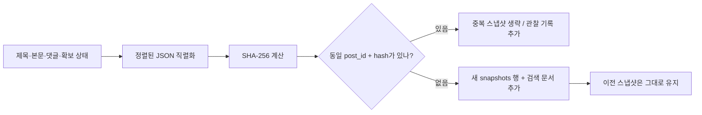

# 블라인드 개인 보관함 — 구조와 동작 원리

작성일: 2026-10-23 KST · 설명 기준: 구현 커밋 `9d4d826` 및 연결된 기기 확인 결과. 이 문서는 학습용이며 실시간 상태판이 아니다.

[인터랙티브 HTML 열기](architecture.html) · [운영 명령과 설치 방법](../OPERATIONS.md)

## 1. 앱 화면을 계속 켜놔야 하나요?

**아니요. 블라인드 알림 보관 앱의 화면은 닫아도 됩니다.** 화면을 끄거나 홈 화면으로 이동해도 알림 접근 서비스가 시스템에 연결되어 있다면 알림을 받을 수 있습니다. 블라인드 앱도 화면에 계속 띄워 둘 필요는 없지만, 로그인과 알림 수신은 유지되어야 합니다.

앱 화면인 `MainActivity`는 서버 주소·기기 연결 키를 설정하고 상태를 확인하는 도구입니다. 실제 알림 처리는 별도 구성 요소인 `BlindListener`가 담당합니다. Android가 알림 접근 권한을 받은 서비스를 연결하고, 새 알림이 게시될 때 콜백을 호출합니다. 이것은 모든 앱이 임의로 받는 일반 브로드캐스트를 등록한 방식과 다릅니다.

| 상황 | 예상 동작과 주의점 |
|---|---|
| 홈 화면으로 이동 / 화면 끄기 | 앱 화면이 없어도 서비스가 연결되어 있으면 수신 가능 |
| 최근 앱 화면에서 보관 앱 카드 제거 | 화면 제거와 설정의 강제 종료는 다르다. 다만 Samsung의 별도 절전 정책까지 동작을 보장하지는 못한다 |
| 설정 → 앱 → 강제 종료 | 백그라운드 동작이 중지될 수 있다. 앱을 다시 열고 연결 테스트를 실행한다 |
| 태블릿 재부팅 | `BOOT_COMPLETED`에서 서비스 재연결과 전송 작업을 요청한다. 부팅·잠금 해제 이후 실제 수신을 확인한다 |
| 배터리 절전 / 초절전 앱으로 분류 | 서비스와 네트워크 전송이 제한되거나 지연될 수 있다 |
| Wi-Fi 또는 Mac mini 일시 중단 | 이미 감지한 알림은 기기 SQLite 큐에 남긴다. 재시도 시각은 Android가 결정한다 |
| USB 케이블 제거 | 실행에 USB/ADB가 필요하지 않다. 설정·디버깅에만 사용했다. 전원과 집 Wi-Fi는 유지한다 |
| 태블릿 전원 꺼짐 | 해당 기기의 실시간 알림 감지는 중단된다. Mac mini의 웹 수집은 독립적으로 계속된다 |

운영 권장: 상시 전원·집 Wi-Fi, 블라인드 로그인과 알림 허용, 보관 앱 알림 접근 유지. Samsung 설정의 **배터리 → 백그라운드 사용 제한**에서 두 앱이 절전/초절전 대상으로 들어가지 않도록 확인합니다. 메뉴 이름은 One UI 버전에 따라 다릅니다. 앱을 화면에 계속 띄워 두는 방법이 절전 설정을 대신하지는 않습니다.

확인한 기기는 Android **13 / API 33**입니다. `RUN_ANY_IN_BACKGROUND`는 기본 허용으로 조회됐지만, 이는 Samsung의 모든 배터리 관리 예외를 확인했다는 뜻은 아닙니다. 장시간 화면 꺼짐·재부팅 이후 실수신 검증은 별도입니다.

## 2. 전체 구조

서로 독립적인 두 입구가 하나의 보관 DB로 합쳐집니다. **웹 입구는 미리 발견하기**, **태블릿 입구는 도착한 알림에 반응하기**를 맡습니다. 태블릿은 알림 센서, Mac mini는 수집·보관·열람 서버입니다.

다이어그램의 API·작업자·DB는 별도 서버들이 아닙니다. **하나의 Python 프로세스** 안에서 HTTP 요청 스레드, 본문 수집 스레드, 댓글 수집 스레드, 유지관리 스레드가 SQLite를 함께 사용합니다. Playwright가 필요할 때 Chromium 자식 프로세스를 실행합니다.

현재 Jenkins, Cloudflare Tunnel, Supabase, Firebase는 이 시스템 실행 경로에 없습니다. 사용자 열람 트래픽은 집 안 LAN에서만 처리합니다.

## 3. 태블릿에서 알림 하나가 도착하면

1. 공식 블라인드 앱이 Android에 알림을 게시합니다.
2. `BlindListener.onNotificationPosted()`가 호출됩니다.
3. 발신 패키지가 `com.teamblind.blind`인지 검사하고 그룹 요약 알림은 건너뜁니다. 다른 앱 알림은 저장·전송하지 않습니다.
4. 알림의 제목과 큰 텍스트 또는 미리보기를 읽습니다. 공개 문자열에 `https://www.teamblind.com/kr/post/...`가 있으면 URL도 추출합니다. 전체 게시글 본문이나 블라인드 내부 저장소를 읽는 것은 아닙니다.
5. 내용을 **태블릿의 SQLite `queue`**에 먼저 저장합니다.
6. 별도 전송 스레드에서 Mac mini의 `POST /api/notifications`로 보냅니다. 연결 키는 HTTP `Authorization: Bearer …` 헤더로 전달하며 문서에 실제 값을 싣지 않습니다.
7. 서버가 2xx로 응답하면 해당 큐 항목을 제거합니다. 실패하면 큐에 남기고 `JobScheduler`로 재시도합니다. 한 번에 최대 100개를 전송합니다.
8. 서버는 `event_key`의 고유 제약으로 중복 알림 저장을 방지합니다. 전송 성공은 **서버가 알림을 접수했다**는 뜻이며 게시글 본문 확보 완료를 뜻하지 않습니다.

`onListenerConnected()`에서는 아직 알림창에 남아 있는 활성 알림도 읽고 전송 작업을 예약합니다. 이미 사라진 모든 과거 알림을 복원하는 기능은 아닙니다.

`JobScheduler`에는 네트워크 연결 조건, 최소 지연 1초, 최초 backoff 30초의 지수 재시도를 요청합니다. 최소 지연은 정확한 실행 예약 시간이 아닙니다. 절전 상태와 OS 판단에 따라 더 늦어질 수 있습니다.

### URL이 없을 때

알림 제목, 미리보기 전체, 미리보기 첫 줄을 각각 공백 정규화하고 5자 이상인 문자열을 저장된 글 제목과 정확히 비교합니다. 후보 게시글 ID가 **하나일 때만** 연결합니다. 유사도 검색이나 AI 추측은 하지 않습니다. 미연결 알림은 남겨 두고 이후 본문 수집이 성공할 때 다시 매칭을 시도합니다. 이 재매칭은 최근 미연결 알림 100개를 대상으로 합니다.

현재 제목 매칭은 기존 `jobs` 행의 우선순위를 올립니다. 7일 재방문이 끝나 이미 `jobs`에서 빠진 오래된 글의 작업을 새로 만들지는 않습니다. URL을 가진 알림과 수동 URL 등록은 대기열을 새로 만들 수 있습니다.

**현재 앱은 알림을 자동 클릭하거나 공식 앱 화면에서 본문을 추출하지 않습니다.** 알림의 정확한 게시글을 항상 알아낼 수 있다고 가정하면 안 됩니다.

## 4. 웹 수집은 태블릿 없이도 진행된다

기본 탐색 대상은 블라블라, 썸·연애, 결혼생활, 토픽 베스트입니다. 목록 탐색 사이 기본 간격은 600초이며, 작업 처리 때문에 정확히 매 시각에 실행되는 스케줄러는 아닙니다. 목록 HTML에 노출된 게시글 링크를 수집하고 게시글 ID로 중복을 제거합니다. 무한 스크롤 전체나 모든 과거 페이지를 순회하는 기능은 현재 없습니다. 페이지의 추천 링크가 섞이면 설정한 채널 이외 글도 발견될 수 있습니다.

| 입력 | 우선순위 |
|---|---:|
| 보관함에서 수동 URL 요청 | 30 |
| URL을 가진 태블릿 알림 | 20 |
| 정확한 제목으로 연결된 알림의 기존 작업 | 10 |
| 아직 미수집인 토픽 베스트 | 8 |
| 나머지 새 글 | 5 |
| 일반 재방문 | 0 |

본문 작업자는 높은 우선순위부터 하나씩 처리합니다. 기본 요청 시작 간격은 최소 5초입니다. 따라서 알림이 들어왔다고 즉시 저장 완료되는 것은 아니며, 실행 중인 요청·대기열·서버 응답의 영향을 받습니다.

본문은 일반 HTTP 요청과 BeautifulSoup 파싱으로 확보합니다. 제목과 본문 DOM이 확인되지 않으면 빈 원문으로 저장하지 않고 오류로 기록합니다. 제목·본문·초기 댓글을 먼저 DB에 커밋한 뒤 댓글이 불완전하면 `comment_jobs`에 넣습니다.

별도 댓글 작업자는 Playwright로 댓글 더보기를 펼칩니다. 기본 확장 루프 예산은 60초, 최대 클릭 40회, 클릭 뒤 대기 2초입니다. 페이지 이동·초기 대기 시간은 이 루프 예산 밖이므로 전체 작업 시간이 60초 이내라는 보장은 없습니다. 이미지·미디어·폰트 요청은 차단합니다.

최근 확인에서 자동 브라우저는 **HTTP 403**을 받았습니다. 해당 댓글 작업자는 1시간 쉬고, 본문 작업자는 별도로 계속 동작합니다. 본문 작업자 자신이 403/429를 받으면 본문·목록 수집도 해당 작업자의 1시간 중단에 들어갑니다. 접근 제한을 우회하지 않습니다.

## 5. 왜 ‘-펑-’으로 바뀌어도 예전 글을 볼 수 있나

| 관찰 시각 — 학습용 예시 | 관찰한 내용 | 보관 결과 |
|---|---|---|
| 10:00 | 처음 확보한 본문, 댓글 3개 | 버전 1 |
| 10:10 | 수정된 본문, 댓글 8개 | 버전 2 추가 |
| 10:30 | 본문 `-펑-` | 버전 3 추가, 버전 1·2 유지 |
| 11:00 | HTTP 404 | 접근 불가 관찰 기록, 보관본 유지 |

해시 대상은 본문만이 아니라 파싱된 전체 payload입니다. 댓글·제목·URL·전체 댓글 표시 수·완전성 플래그가 달라져도 버전이 추가될 수 있습니다. `posts` 행에는 최근 메타데이터가 갱신되지만, 실제 이전 내용은 `snapshots`에 별도로 남습니다. ‘원본’은 작성 직후 원문이 아니라 **우리가 처음 확보한 버전**입니다.

기본 재방문 간격은 최초 발견 후 1시간 이내 10분, 24시간 이내 30분, 이후 6시간입니다. 최초 발견 후 7일이 지나면 성공적으로 처리한 작업은 재방문 대기열에서 빠집니다. **보관본 자체가 7일 후 삭제되는 것은 아닙니다.** 실패 작업은 별도 backoff로 재시도하므로 이 종료 조건과 다르게 남을 수 있습니다.

## 6. 저장 구조와 검색

| 위치 / 테이블 | 역할 |
|---|---|
| 태블릿 `notifications.sqlite`의 `queue` | 서버 접수 전까지 보유하는 전송 대기 알림 |
| Mac mini `posts` | 게시글 ID·URL·최근 제목·채널·수집 상태 |
| `snapshots` | 버전별 파싱 결과 JSON, 수집 시각, 해시 |
| `observations` | 같은 내용 재확인, 접근 실패 등 관찰 기록 |
| `jobs` / `comment_jobs` | 본문 수집·재방문 / 댓글 확장 대기열 |
| `notifications` | 수신 알림, 중복 키, 미연결·연결 상태 |
| `search` | 새 스냅샷마다 추가되는 제목·본문·댓글 검색 문서 |
| `events` | 시작·탐색·백업·작업 오류 등 운영 이벤트 |

DB는 SQLite WAL 모드이며 연결마다 외래 키 검사를 켭니다. `search`는 FTS5 가상 테이블이지만 **현재 사용자 검색 질의는 FTS MATCH가 아니라 LIKE 부분 검색**을 사용합니다. 그래서 한글의 일부 문자열로 이전 버전까지 찾을 수 있습니다. 검색 결과는 글 단위로 나오며, 해당 문구가 있는 옛 버전은 버전 선택기에서 확인합니다.

코드: `/Volumes/sn850x/git/creative-plate/blind-crawler`

운영 데이터: `/Volumes/sn850x/blind-archive-data/archive.sqlite`

설정: 같은 데이터 폴더의 `config.json`. 기기 키는 별도 파일에 생성되며 Git에 넣지 않습니다. 문서에도 실제 키·실제 알림 본문은 포함하지 않습니다.

## 7. 운영과 장애 복구

- PM2 `blind-archive`가 Python 프로세스를 관리합니다. 프로세스 비정상 종료는 기본 5초 지연 재시작, 메모리 기준 1GiB 재시작 설정이 있습니다. 무한히 어떤 실패든 복구된다는 뜻은 아니며 PM2 재시작 상한도 있습니다.
- 본문·댓글 작업자 예외는 내부 감시 루프가 기록하고 30초 후 다시 시작을 시도합니다.
- 사용자 로그인 이후 launchd가 시작 시점과 5분 간격으로 PID를 확인합니다. 이미 살아 있으면 재시작하지 않습니다. PID 확인은 작업의 실제 진행까지 검사하는 헬스체크가 아닙니다.
- 시작 스크립트와 PM2 설정 사본은 `~/Library/Application Support/blind-archive/`에 둡니다. 코드와 데이터는 외장 SSD를 사용합니다. SSD의 스크립트를 launchd가 직접 읽다가 접근 제한에 걸린 문제를 피하기 위한 구성입니다.
- OS 재부팅 후 **사용자 로그인 전 실행**은 보장하지 않습니다. 실제 재부팅 복구 시험은 프로세스 중지·복구 시험과 별개입니다.
- 유지관리 스레드는 시작 시와 날짜가 바뀐 뒤 백업하고, 매분 공간을 확인합니다. 공간이 5GiB 미만이면 본문·목록 작업자에 10분 중단을 설정합니다. 현재 댓글 작업자에는 같은 공간 중단이 공유되지 않습니다.
- 백업은 SQLite backup API와 integrity_check를 사용하고 요일별 7개로 순환합니다. 같은 외장 SSD의 복사본이므로 **SSD 자체 고장에 대비한 다른 장치 백업은 아닙니다.**

## 8. 집 안 통신과 권한의 경계

열람 주소는 `http://192.168.50.173:5067/`입니다. 열람 로그인은 없으므로 허용된 LAN에서 접속 가능한 사람은 내용을 읽을 수 있습니다. 현재 설정 조회 API도 같은 LAN 정책 안에 있어 연결 키를 표시할 수 있습니다. 기기 키가 별도 사용자 계정이나 열람 권한 분리를 제공하는 것은 아닙니다.

서버는 사설/루프백 클라이언트와 로컬 IP Host를 확인하고, 다른 Origin 및 cross-site 브라우저 요청을 거부합니다. 알림 쓰기 요청에는 기기 키를 검사합니다. HTTP는 TLS로 암호화되지 않으므로 신뢰하는 집 LAN을 전제로 합니다. 외부 Tunnel이나 공용 인터넷에 연결하는 용도로 설계하지 않았습니다.

## 9. 현재 구현의 한계

- 최초 수집 전에 삭제·수정된 내용은 복구할 수 없습니다. 수집 간격·대기열 사이에 사라지는 글도 놓칠 수 있습니다.
- 댓글의 확보 개수와 사이트 표시 전체 수를 비교하지만, 표시 수가 맞는다고 역사상 존재했던 모든 댓글을 확보했다는 의미는 아닙니다.
- 앱 전용 회사 라운지처럼 공개 웹에서 접근할 수 없는 글은 본문 수집이 되지 않을 수 있습니다.
- URL 없는 추천 알림과 iPhone/태블릿 간 알림 차이는 실제 알림을 관찰해야 합니다. iPhone 알림을 태블릿이 대신 받는다고 가정하지 않습니다.
- 이미지·동영상·스크린샷, 자동 앱 클릭, 화면 OCR, 비공개 API/인증 추출은 현재 구현하지 않았습니다.
- 404/410은 해당 시점 접근 불가 관찰값입니다. 오류나 로그인 문제를 작성자의 삭제로 단정하지 않습니다.
- 사용자 개인 운영 승인과 플랫폼의 자동 수집 허용은 별개입니다. 지속 운영에는 블라인드 약관의 제한이 적용될 수 있습니다.

## 10. 소스 코드를 읽는 순서

1. [MainActivity.java](../android/app/src/main/java/dev/blindarchive/MainActivity.java): 화면과 서비스 역할 분리.
2. [BlindListener.java](../android/app/src/main/java/dev/blindarchive/BlindListener.java): 이벤트 수신·패키지 필터·로컬 큐.
3. [Queue.java](../android/app/src/main/java/dev/blindarchive/Queue.java) / [UploadJob.java](../android/app/src/main/java/dev/blindarchive/UploadJob.java): 접수 응답·재시도·중복 전송 가능성.
4. [server.py](../blind_archive/server.py): HTTP 경계·기기 키·작업자 스레드 구성.
5. [collector.py](../blind_archive/collector.py) / [parser.py](../blind_archive/parser.py): 우선순위·웹 탐색·본문 파싱·댓글 분리.
6. [db.py](../blind_archive/db.py): append-only 스냅샷·고유 제약·검색.
7. [backup.py](../scripts/backup.py) / [ensure-running.sh](../scripts/ensure-running.sh): 데이터 복사와 프로세스 복구의 차이.

학습 질문: ① 왜 전송보다 큐 저장을 먼저 할까? ② HTTP 202와 본문 저장 완료는 왜 다를까? ③ 알림이 없더라도 웹 수집이 필요한 이유는? ④ `posts`를 갱신해도 `snapshots`를 유지하면 무엇이 달라질까? ⑤ 재시도가 있는 전송에서 `event_key`가 필요한 이유는?

## 참고 자료

- [Android NotificationListenerService](https://developer.android.com/reference/android/service/notification/NotificationListenerService): 시스템이 연결하는 알림 서비스와 콜백.
- [Android Doze / App Standby](https://developer.android.com/training/monitoring-device-state/doze-standby): 화면 꺼짐·유휴 상태의 네트워크와 작업 지연.
- [Android 강제 종료 상태 설명](https://developer.android.com/about/versions/15/behavior-changes-all#stopped-state): stopped 상태와 사용자 재실행. Android 15 추가 변경과 기존 stopped-state 개념을 구분해 읽는다.
- [Samsung Sleeping apps](https://www.samsung.com/us/support/answer/ANS10003442/): 절전·초절전·절전 예외 앱 정책.
- [블라인드 이용약관](https://kr.teamblind.com/setting/term): 자동 수집과 콘텐츠 이용 조건.
